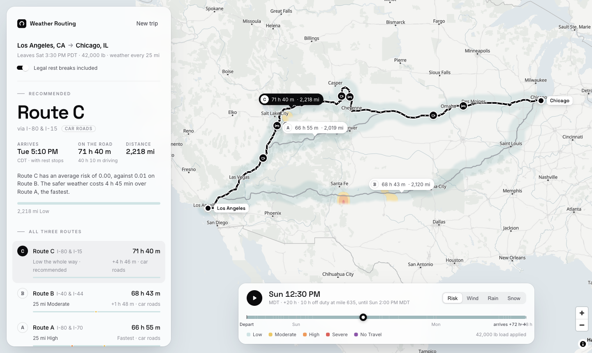

# Weather-Aware Truck Routing

Pick the safest truck route, judged by the weather **at the hour the truck reaches each part of the road**, and by the load it carries.

**[Live app](https://weather-truck-routing-ashy.vercel.app)** · React + Django · try the "LA → Chicago" sample



## How it meets the brief

| The brief asks for | What the app does |
|---|---|
| Origin, destination, departure, load | Place search (cities, addresses, ports, ZIPs); departure in your own time zone, up to 7 days ahead; cargo weight 0 to 80,000 lb |
| 3 route options from a routing API | Valhalla truck routing, with OSRM when Valhalla refuses a long trip. Each route says which router made it |
| Weather every 10 / 25 / 50 mi at the truck's ETA | A checkpoint at the start, every N miles and the end; each reads the forecast for the hour the truck arrives there, legal rest stops included |
| Risk from the table and load rules | Every checkpoint is classified and names its cause ("No Travel: wind 47 mph with a 42,000 lb load (Severe at 30,000 lb or less)") |
| Recommend the best route | The brief's order, with the reason in plain words and the time it costs |
| Map: routes, checkpoints, risk, ETAs, summaries | Routes coloured by risk, checkpoint and rest-stop cards, route labels with time and distance, a timeline that flies the map |
| Corridor heatmap with a 0–48 h slider | A WebGL layer drawn per pixel; all 49 hours are fetched once, so sliding never refetches (60 fps) |

## Key decisions

- **ETAs include legal rest breaks.** A truck can't drive 28 hours straight, so a 30-min break after 8 h of driving and 10 h off duty at the 11-h driving limit are added; otherwise the weather would be read at hours the truck isn't there. A switch turns them off and shows how much earlier non-stop would arrive.
- **Risk follows the table exactly.** The actual reading is classified. Where two bands share an edge (25 mph, 0.25 in/hr…) the higher, safer band applies, except where the table says ">" for No Travel (rain > 1.00, snow > 3.0). Load rules are strict: exactly 30,000 or 40,000 lb doesn't escalate. Rain and snow are scored separately; steady wind is scored and gusts are shown. The worst condition sets the level.
- **Recommendation in the brief's order, plus one rule.** Fewest Severe miles, then High miles, then lowest average risk, then shortest travel time, with one rule added first: fewest No Travel miles, so a route the rules say not to drive can never win. Miles are counted halfway to each neighbouring checkpoint; average risk is compared at the precision shown (0.01).
- **Honest alternatives.** If the router only finds two genuinely different roads, the app shows two and says why, instead of padding with a detour no dispatcher would take.

## Run it locally

No API keys needed.

```bash
# backend (Python 3.12+)
cd backend
python -m venv .venv && .venv/bin/pip install -r requirements.txt
.venv/bin/python manage.py runserver 8000

# frontend (Node 20+), in another terminal
cd frontend
npm install && npm run dev        # http://localhost:5173 (proxies /api to :8000)
```

**Tests:** `cd backend && .venv/bin/python manage.py test` (96) · `cd frontend && npm test` (79). No test calls a real API.

## How it's built

- `backend/trips/domain/`: the rules in plain Python (risk, exposure, ranking, hours of service), no Django, unit-tested.
- `backend/trips/`: routing, weather and place-search clients, the planner, and a thin DRF view (`POST /api/plans/`, `GET /api/places/`).
- `frontend/src/`: React 19, TypeScript and MUI; MapLibre for the map; the heatmap is a small WebGL2 layer. Works on phones (bottom sheet and compact slider).
- **Hosting:** React on Vercel, Django on Cloud Run (kept warm by a 5-minute Cloud Scheduler ping). Vercel forwards `/api/*` to Cloud Run, so there is one origin and no CORS.

## Limits

- **Free services.** Valhalla's public server refuses very long trips (then OSRM, car roads, is used and labelled). Open-Meteo's free tier is rate-limited per IP: the app counts down and retries when busy, and says so plainly when the daily limit is reached.
- **Rest model, not full compliance.** It models the 30-min and 11-h rules from the start of the trip; it doesn't know the driver's remaining hours (the 14-h and 70-h rules don't bind on a single trip).
- Contiguous US only. Forecasts more than 72 h out are labelled long-range. The map needs WebGL2.

## In production I would

Use a commercial truck router (bridge heights, hazmat), a paid or self-hosted Open-Meteo and Photon, a shared cache (Redis) instead of per-instance memory, and start rest breaks from the driver's logbook hours.
